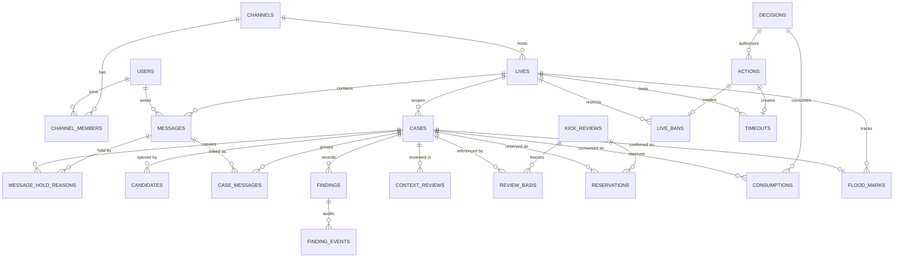

# LIVE:GUARD ERD v1.0

작성: Backend 1 · 기준: [정책 원본 v3.1](policy/README.md)(PROJECT·POLICY·CONTRACTS·ARCHITECTURE)과 [TBD-decisions](policy/TBD-decisions.md)(ERD v1.0 구현 결정 E-1~E-8 포함)

- 출발점은 B2가 만든 `V200__guard_cases_and_findings.sql`이다. CONTRACTS §3의 저장 객체에 맞춰 컬럼을 보완하고 테이블을 추가했다.
- 문서에 이름이 있는 필드만 snake_case로 옮겼다. 상세 DDL(타입 세부, 인덱스 이름)은 마이그레이션에서 정한다.
- **모든 정책 범위(집계, 도배, 재적발, TIMEOUT, 강퇴)는 `live_id`다.** `channel_id`는 고정 채널 식별자로만 쓰고 정책 범위를 대체하지 않는다(PROJECT §2).
- 담당: **B1** = `platform` 스키마(Flyway `V1xx`), **B2** = `guard` 스키마(`V2xx`). 이미 머지된 마이그레이션은 고치지 않고 새 버전으로 추가한다.

## 1. 처리 흐름

```
채팅 POST (liveId) → 활성 live ban·TIMEOUT 검사(차단이면 거부, 메시지·사건 생성 없음)
                   → 1차 필터 → handlingRoute 1개 + matchingTags 전부
  ├ PASS              → PUBLIC, Agent 미호출
  ├ RULE_CONFIRMED    → 확실한 욕설·링크: BE가 같은 처리 안에서 위반 확정 → HIDDEN + 유형별 표
  ├ FLOOD_REVIEW      → 같은 userId·liveId 10초 안 같은 문장 3회째부터 HELD → BE 규칙으로 확정(TBD-11) → 중복 HIDE (+표)
  ├ PII_INVESTIGATION → HELD → AI 조사 → 정상은 자기 원인 해제 / 위반은 BE 검증 후 확정 / 부족하면 HELD 유지
  └ CONTEXT_REVIEW    → HELD → AI 조사 → 판정과 무관하게 운영자 결정(interrupt) → 정상 확정 시 해제 / 위반 확정 시 HIDE + 표
확정 사건 저장 → 같은 userId·liveId 최근 24시간 통합 사건 3건 이상 → 강퇴 심사(예약, interrupt)
             → 운영자 승인·거절(결정 + 소진) → 같은 thread_id 재개 → 승인이면 재검증 후 kick_user → 방송 종료까지 live ban
```

- 사람 승인이 없는 경로의 가림·제한은 BE 업무 규칙이 실행한다. Agent의 MCP 변경 도구는 사람 승인 interrupt 뒤에서만 호출한다(TBD-12).
- AI 제안(`findings.source = AI_PROPOSAL`)은 집계하지 않는다. BE 확정(`source = BACKEND`, `status = CONFIRMED`)만 집계한다.

## 2. 관계도



`context_reviews`와 `kick_reviews`의 `review_id`가 `decisions.review_id`·`consumptions.review_id`가 가리키는 검토 요청이다(ReviewKind로 구분). Python 쪽 `rag.policy_chunks`(rag-mcp)와 LangGraph checkpointer는 Flyway 관리 대상이 아니다.

## 3. 테이블

### platform (B1)

| 테이블 | 컬럼 | 비고 |
| --- | --- | --- |
| `users` | `id` PK, `username` UK, `password_hash`, `nickname`, `role`(VIEWER, MODERATOR, PLATFORM_ADMIN) | v0.5 유지 |
| `channels` | `id` PK, `name`, `official_hosts` jsonb, `official_events` jsonb | v0.5 유지. `official_hosts`는 **링크 허용 예외가 아니다.** 사칭 조사 참고 자료로만 쓴다(POLICY §2, CONTRACTS §7) |
| `channel_members` | `channel_id`·`user_id` PK, `member_role`(VIEWER, STREAMER, OFFICIAL_STAFF, MODERATOR) | v0.5 유지. 담당 운영자 = 그 채널의 MODERATOR. liveId 범위 권한은 방송의 `channel_id`로 확인 |
| **`lives`** | `id` PK(liveId), `channel_id` FK, `started_at`, `ended_at`(null = 방송 중) | **신규(E-1).** 상태 컬럼 없음. 채널당 진행 중 방송 1개. 시작·종료는 운영자 API(openapi v1.0) |
| `messages` | `id` PK, **`live_id` FK**, `channel_id` FK, `author_id` FK, `client_message_id`, `text`(1..500), `normalized_text`(norm-v1), `filter_result`, `visibility`(PUBLIC, HELD, HIDDEN), `case_id` FK(소유 사건), `version`, `sent_at` | `live_id` 추가. `filter_result`의 REVIEW는 v3.1 경로에서 쓰지 않는다 |
| **`message_hold_reasons`** | `message_id` FK, `case_id` FK, `reason`(handlingRoute 값), `created_at`, `released_at` | **신규(E-2).** 해제는 자기 원인만. 미해제 원인이 남아 있으면 PUBLIC으로 되돌리지 않는다 |

### guard (B2)

| 테이블 | 컬럼 | 비고 |
| --- | --- | --- |
| `cases` | `id` PK, `channel_id` FK, `user_id` FK, **`live_id` FK NOT NULL**, **`policy_version` NOT NULL**, `handling_route`, `status`, **`confirmation_status`**, `snapshot_id`, `evidence_version`, `version`, `judged_at`, `occurred_at`, `created_at` | V200 기준. `live_id`·`policy_version`은 NOT NULL로, `confirmation_status`(PENDING, CONFIRMED_VIOLATION, CONFIRMED_NORMAL, CANCELLED, E-3) 추가. `status`는 처리 진행 상태로 유지. DEFER는 `decisions`에만 기록하고 PENDING 유지 |
| `candidates` | `message_id` PK·FK, `case_id` FK, `filter_result`, `matching_tags`, `filter_version`, `related_message_ids`, `sent_at`, `snapshot_id` UK, `evidence_version` | V200 유지. 1차 필터 입력 스냅샷(`filter_version` 예: `norm-v1+dict-v2`, TBD-08) |
| `case_messages` | `case_id`·`message_id` PK, `owned`, `is_target` | V200 유지. `is_target` = 제재 대상(TARGET), 아니면 증거. 메시지는 한 사건만 소유(`owned`) |
| `findings` | `id` PK, `case_id` FK, `category`(5종), `source`(AI_PROPOSAL, BACKEND), `verdict`, `status`(PROPOSED, CONFIRMED, REVOKED), `policy_version`, `evidence_reference`, `evidence_version`, `created_at`, **`confirmed_at`**, **`revoked_at`** | V200 기준. `confirmed_at`·`revoked_at` 추가. 부분 유형 취소는 finding 단위. 유효 finding이 0개면 사건 취소(TBD-04) |
| `finding_events` | `id` PK, `finding_id` FK, `event_type`, `decision_reference`, `reason`, `created_at` | V200 유지. 감사 이력 |
| **`context_reviews`** | `review_id` PK, `case_id` FK, `thread_id`, `ai_verdict`, `evidence_version`, `status`(ReviewStatus) | **신규.** AI 정상 제안이어도 결정 대기 |
| **`kick_reviews`** | `review_id` PK, `thread_id`, `basis_snapshot_id`, `version`, `status`(ReviewStatus) | **신규.** 실제 심사 기준 집합은 `review_basis`로 고정 |
| **`review_basis`** | `review_id` FK, `case_id` FK | **신규.** `basisCaseIds`. 3건 초과 시 확정 시각이 가장 오래된 3건(TBD-06) |
| **`reservations`** | `review_id` FK, `case_id` FK, `state`(RESERVED, CONSUMED, RELEASED) | **신규(E-4).** 대기 중 다른 심사가 같은 사건을 쓰지 못하게 함 |
| **`decisions`** | `decision_id` PK, `review_id` FK UK, `kind`(ReviewKind), `value`(ContextDecision 또는 KickDecision), `operator_id`, `decided_at`, `client_request_id` | **신규(E-5).** 같은 요청 재전송은 같은 결과, 다른 요청은 409 |
| **`consumptions`** | `case_id` FK, `review_id` FK, `decision_id` FK, `consumed_at` | **신규.** 승인·거절 모두 기록. 위반 사실과 TIMEOUT 이력은 지우지 않음 |
| **`actions`** | `action_id` PK, `type`(HIDE, TIMEOUT, RELEASE_HELD, KICK), `live_id` FK, `user_id` FK, `decision_id` FK(nullable, 규칙 경로는 없음), `status`(ActionStatus), `observation`(CONFIRMED, UNKNOWN), `idempotency_key` UK, `attempt_count`, `retry_count` | **신규.** 승인 사실과 실행 결과 분리. KICK은 최초 + 재시도 최대 2회 |
| **`timeouts`** | `live_id` FK, `user_id` FK, `action_id` FK, `starts_at`, `expires_at` | **신규(E-6).** 교체는 새 만료가 더 늦을 때만(TBD-09), 기록은 모두 남김 |
| **`live_bans`** | `live_id` FK, `user_id` FK, `action_id` FK, `active_until_live_end` | **신규.** 방송 종료까지 입장·채팅 금지. 24시간 만료 없음, 새 liveId에 승계 안 함 |
| **`flood_marks`** | `live_id` FK, `user_id` FK, `text_hash`, `case_id` FK, `confirmed_at`, `notice_event_id`(nullable) | **신규(E-7).** `text_hash` = norm-v1 정규화 문장의 SHA-256. 재적발 창 = `confirmed_at + 24시간` |

**v0.5 대비 삭제**: `kicks`(→ `actions` KICK + `live_bans`, 86400초 상한 제거), v0.5 ERD에만 있던 `cases`의 `verdict`·`category`·`reason`·`evidence_message_ids`·`policy_snapshots`·`counted`·`kick_review_id`·`released_at`·`released_by`·`thread_id`·`trace_id`(→ `findings`, `context_reviews`, `kick_reviews`, `review_basis`, `consumptions`로 분리).

## 4. 제약·인덱스

| 테이블 | 제약·인덱스 | 이유 |
| --- | --- | --- |
| lives | 부분 유일 `(channel_id) WHERE ended_at IS NULL` | 채널당 진행 중 방송 1개 |
| messages | `UNIQUE(live_id, author_id, client_message_id)` | 재전송 중복 제거 |
| messages | 인덱스 `(live_id, sent_at DESC)` | 이력 조회 |
| messages | 인덱스 `(live_id, author_id, normalized_text, sent_at)` | 도배 10초 창, 묶음 열림 확인 |
| message_hold_reasons | 인덱스 `(message_id) WHERE released_at IS NULL` | 미해제 원인 확인 |
| case_messages | 부분 유일 `(message_id) WHERE owned` | 메시지는 한 사건만 소유 (V200) |
| findings | 부분 유일 `(case_id, category) WHERE status = 'CONFIRMED'` | 같은 사건의 중복 유형 제거 (V200) |
| review_basis | `PRIMARY KEY(review_id, case_id)` | 기준 집합 고정 |
| reservations | 부분 유일 `(case_id) WHERE state = 'RESERVED'` | 대기 중 심사 중복 사용 금지 |
| decisions | `UNIQUE(review_id)` | 결정 1회 |
| consumptions | `PRIMARY KEY(case_id, review_id)` | 소진 관계 보존 (사용자 카운터 초기화로 구현하지 않음) |
| actions | `UNIQUE(idempotency_key)` | 실제 효과 1회 |
| live_bans | `UNIQUE(live_id, user_id, action_id)` | 같은 실행으로 중복 금지 생성 방지 |
| timeouts | 인덱스 `(live_id, user_id, expires_at)` | 전송 차단 확인 |
| flood_marks | 인덱스 `(live_id, user_id, text_hash, confirmed_at)` | 재적발 확인 |

## 5. 핵심 쿼리

`:now`·`:sentAt`은 주입 Clock의 서버 수신 UTC 시각을 마이크로초로 자른 값이다(TBD-05).

**전송 차단** (먼저 검사, 차단이면 메시지·사건·도배 카운터를 만들지 않음, AC-10):

```sql
-- 활성 live ban: 방송이 아직 진행 중이면 유효
SELECT 1 FROM guard.live_bans b JOIN platform.lives l ON l.id = b.live_id
WHERE b.live_id = :liveId AND b.user_id = :userId AND b.active_until_live_end AND l.ended_at IS NULL;

-- 활성 TIMEOUT
SELECT max(expires_at) FROM guard.timeouts
WHERE live_id = :liveId AND user_id = :userId AND expires_at > :now;
```

**도배 10초 창** (현재 메시지 포함 3회 이상이면 FLOOD_REVIEW):

```sql
SELECT id FROM platform.messages
WHERE live_id = :liveId AND author_id = :userId AND normalized_text = :normalizedText
  AND sent_at > :sentAt - interval '10 seconds'     -- 하한 제외: 정확히 10초 전은 불포함
ORDER BY sent_at, id;                               -- relatedMessageIds (오래된 순)
```

**도배 사건 묶기 (TBD-04)**: 재사용 조건은 **같은 `user_id`·`live_id`·문장의 묶음이 열려 있음**이다. 사건 상태(ANALYZING 여부, `judged_at`)는 보지 않는다. 그래서 3번째에서 즉시 확정(TBD-11)해도 같은 묶음의 4·5번째는 같은 사건에 붙고, 한 번의 도배가 강퇴 집계에서 1건이 된다.

```sql
-- 열린 묶음: 위 10초 창 안에 이미 사건을 소유한 같은 문장 메시지가 있으면 그 사건
SELECT cm.case_id FROM platform.messages m
JOIN guard.case_messages cm ON cm.message_id = m.id AND cm.owned
WHERE m.live_id = :liveId AND m.author_id = :userId AND m.normalized_text = :normalizedText
  AND m.sent_at > :sentAt - interval '10 seconds'   -- 마지막 반복 후 10초가 지나면 묶음 종료
ORDER BY m.sent_at DESC, m.id DESC
LIMIT 1;
-- 결과 없음 → 새 사건. 앞의 두 메시지는 증거로 연결만 하고 가리지 않는다(is_target = false)
```

**도배 재적발** (첫 확정 후 24시간 안 같은 문장은 1회로도 새 도배 사건, POLICY §7):

```sql
SELECT case_id FROM guard.flood_marks
WHERE live_id = :liveId AND user_id = :userId AND text_hash = :textHash
  AND confirmed_at + interval '24 hours' > :sentAt;
```

**강퇴 집계** (신규 심사 후보, POLICY §8, CONTRACTS §6):

```sql
SELECT DISTINCT c.id FROM guard.cases c
JOIN guard.findings f ON f.case_id = c.id
WHERE c.live_id = :liveId AND c.user_id = :userId
  AND f.source = 'BACKEND' AND f.status = 'CONFIRMED' AND f.verdict = 'VIOLATION'
  AND f.confirmed_at > :now - interval '24 hours'   -- 현재 사건 포함
  AND NOT EXISTS (SELECT 1 FROM guard.consumptions x WHERE x.case_id = c.id)
  AND NOT EXISTS (SELECT 1 FROM guard.reservations r WHERE r.case_id = c.id AND r.state = 'RESERVED');
-- 3건 이상이면 강퇴 심사 요청. 다섯 유형 통합, 한 사건의 여러 유형은 1건
```

**TIMEOUT 이력** (유형별 제재표의 "이전 확정", TBD-03):

```sql
SELECT count(DISTINCT c.id) FROM guard.cases c
JOIN guard.findings f ON f.case_id = c.id
WHERE c.live_id = :liveId AND c.user_id = :userId AND c.id <> :currentCaseId
  AND f.category = :category AND f.source = 'BACKEND' AND f.status = 'CONFIRMED' AND f.verdict = 'VIOLATION';
-- 범위는 같은 방송 전체(history-scope=LIVE). 소진된 사건도 포함, 취소(revoked_at)는 제외
```

**승인 재검증** (승인 실행 근거, CONTRACTS §6·§9): `review_basis`의 기준 사건 집합을 그대로 쓰고, 각 사건이 여전히 확정·시간창 안·같은 userId/liveId인지 확인한다. 소진은 **이 review의 decision이 만든 것만** 허용하고 다른 심사의 소진은 거부한다. 신규 심사용 집계(소진 제외)를 재검증에 그대로 쓰지 않는다.

**판정 처리 순서**

| 경로 | 확정 주체 | 저장 | 메시지 |
| --- | --- | --- | --- |
| RULE_CONFIRMED | BE 규칙 | `findings`(BACKEND, CONFIRMED), `actions`(HIDE, 표에 따라 TIMEOUT), `timeouts` | 같은 처리 안에서 HIDDEN |
| FLOOD_REVIEW | BE 규칙(TBD-11) | 위와 같음 + `flood_marks` | 3번째 이후 중복 HIDE, 첫 두 메시지는 공개 유지 |
| PII_INVESTIGATION | AI 판정 → BE 검증 | AI 제안은 `findings`(AI_PROPOSAL), 확정은 BACKEND | 정상이면 자기 원인 해제, 부족하면 HELD 유지 |
| CONTEXT_REVIEW | 운영자 결정 | `context_reviews`, `decisions`(ContextDecision), 확정 시 `findings`(BACKEND) | 정상 확정 시 자기 원인 해제, 위반 확정 시 HIDE + 표, DEFER는 HELD 유지 |
| 강퇴 | 운영자 승인 + 재검증 | `kick_reviews`, `review_basis`, `reservations`, `decisions`, `consumptions`, `actions`(KICK), `live_bans` | 기존 HIDE·TIMEOUT 유지 |

모든 경로가 확정 사건을 저장하면 강퇴 집계를 확인한다. 결정 저장과 소진은 한 트랜잭션(또는 outbox)으로 함께 기록한다. 이벤트는 커밋 후 발행한다.

## 6. enum

| enum | 값 | 비고 |
| --- | --- | --- |
| FilterResult | PASS, REVIEW, HOLD, FLOOD | **REVIEW는 v3.1 경로에서 미사용** (신규 의미 부여 금지) |
| HandlingRoute | PASS, RULE_CONFIRMED, CONTEXT_REVIEW, PII_INVESTIGATION, FLOOD_REVIEW | 우선순위 RULE_CONFIRMED > FLOOD_REVIEW > PII_INVESTIGATION > CONTEXT_REVIEW > PASS (TBD-02) |
| Category | PROFANITY, HARASSMENT, FLOOD, PHISHING, PII_EXPOSURE | 유형별 TIMEOUT 계산 |
| MatchingTag | ATTACK_TERM, CERTAIN_PROFANITY, OFFICIAL_CLAIM, CREDENTIAL_REQUEST, **LINK**, REPEATED_TEXT, **PII_PHONE**, **PII_ACCOUNT**, **PII_EMAIL** | v0.5의 `UNOFFICIAL_URL`을 공식 링크 포함 `LINK`로, PII 태그 3종 추가(E-8) |
| Visibility | PUBLIC, HELD, HIDDEN | |
| Verdict | NO_VIOLATION, VIOLATION, NEEDS_REVIEW | 출처(`findings.source`)와 함께 저장 |
| confirmation_status | PENDING, CONFIRMED_VIOLATION, CONFIRMED_NORMAL, CANCELLED | E-3 |
| ReviewKind | CONTEXT, KICK | |
| ContextDecision | CONFIRM_NORMAL, CONFIRM_VIOLATION, DEFER | DEFER는 공개 승인 아님 |
| KickDecision | APPROVE, REJECT | |
| ReviewStatus | PENDING, DECIDED | 결정 상태, 실행 상태와 분리 |
| reservations.state | RESERVED, CONSUMED, RELEASED | E-4 |
| ActionType | HIDE, TIMEOUT, RELEASE_HELD, KICK | |
| ActionStatus | PENDING, RUNNING, SUCCEEDED, FAILED | |
| Observation | CONFIRMED, UNKNOWN | UNKNOWN이면 결과 미확인(실패로 단정 안 함) |

`openapi.yaml`과 Java enum은 이 문서에 맞춰 v1.0 계약 작업에서 바꾼다(현재 Java `MatchingTag`는 v0.5 6종).

## 7. 담당

| 영역 | 테이블·기능 | 담당 |
| --- | --- | --- |
| 인증 | users, 세션 로그인, 역할·채널 권한 | B1 |
| 방송·채팅 | lives, channels, channel_members, messages, message_hold_reasons, 1차 필터, 전송 차단 확인, 채팅 SSE | B1 |
| 도배 재적발 | flood_marks (탐지는 B1 전송 경로, 확정 기록은 B2) | B1·B2 |
| 사건·판정 | cases, candidates, case_messages, findings, finding_events, context_reviews, decisions(CONTEXT) | B2 |
| 제재 | actions, timeouts, live_bans, 유형별 표 계산 | B2 |
| 강퇴 | kick_reviews, review_basis, reservations, decisions(KICK), consumptions | B2 |
| 내부 조회 API | context·channel info (데이터 주인) | B1 |

## 8. 미정 (정책 원본의 TBD 중 이 ERD에 남은 것)

| TBD | 남은 결정 | 이 문서의 처리 |
| --- | --- | --- |
| TBD-04 | 재적발 메시지마다 별도 사건으로 쪼갤지 | 묶음 규칙(마지막 반복 후 10초)을 재적발에도 적용 |
| TBD-06 | 재검증 탈락 후 검토 상태(INVALIDATED) | `kick_reviews.status`(ReviewStatus)에 값을 추가할지는 openapi v1.0에서 정함 |
| TBD-07 | kick 일시 오류 코드·간격 | `actions.attempt_count`·`retry_count`로 예산만 보존 |
| TBD-10 | 검토 대기 만료·재배정 | 만들지 않음(자동 공개 없음) |
