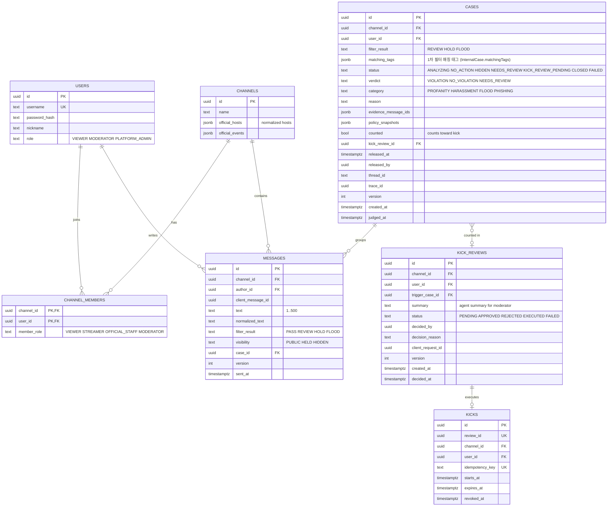

# LIVE:GUARD ERD v0.5

작성: Backend 1 · 상태: **구현 기준안 (팀 확정 필요 항목은 6절)**

## 1. 구조 요약

```
채팅 POST → 1차 필터 ─ PASS ──────────────────────────────► PUBLIC
                      └ REVIEW/HOLD/FLOOD → 사건 생성 (HOLD·FLOOD는 즉시 HELD)
                                               ↓
                        Agent 조사 (MCP 조회 도구 + RAG 검색)
                                               ↓
                        판정 제출 → Backend 업무 규칙
                          ├ VIOLATION     → 메시지 HIDDEN, 누적 횟수 계산
                          ├ NO_VIOLATION  → HELD였으면 PUBLIC 복원
                          └ NEEDS_REVIEW  → 상태 유지, 운영자 검토 목록
                                               ↓
                        누적 3회 도달 → 강퇴 검토 생성
                          → Agent가 kick_user 앞에서 interrupt (checkpointer 저장)
                          → 운영자 APPROVE / REJECT → 같은 thread_id로 재개
                          → APPROVE면 kick_user 실행 (destructiveHint)
```

- 메시지 가림·복원은 **Backend 업무 규칙**이다. Agent는 판정만 제출하고 변경 도구를 호출하지 않는다.
- Agent의 변경 도구는 `kick_user` 하나이며 반드시 interrupt로 멈춘다 (강의자료 표 6-3 Guardrails 최소 기준).
- 운영자의 오탐 해제는 사람이 직접 하는 Backend 기능이다 (Agent 도구 아님).

## 2. 관계도



Python 쪽: `rag.policy_chunks`(rag-mcp), LangGraph checkpointer(Agent). Flyway는 `platform`·`guard` 스키마만 관리한다.

v0.4 대비 삭제: tenants, holds·visibility_reasons, case_messages(→ `messages.case_id`), case_snapshots, message_judgments, findings 4종, action_plans, actions, appeals, review_decisions, tasks(lease·fence), outbox, processed_events, notifications, stream_events, policy_sets, client_requests, security_facts. **25개 → 7개.**

## 3. 제약·인덱스

| 테이블 | 제약·인덱스 | 이유 |
| --- | --- | --- |
| messages | `UNIQUE(channel_id, author_id, client_message_id)` | 재전송 중복 제거 |
| messages | 인덱스 `(channel_id, sent_at DESC)` | 이력 조회 |
| messages | 인덱스 `(channel_id, author_id, normalized_text, sent_at)` | 도배 10초 3회 판정 |
| cases | 인덱스 `(channel_id, user_id, judged_at) WHERE counted AND released_at IS NULL AND kick_review_id IS NULL` | 누적 횟수 계산 |
| kick_reviews | 부분 유일 `(channel_id, user_id) WHERE status = 'PENDING'` | 같은 사용자에 대한 검토 1건 |
| kick_reviews | `UNIQUE(decided_by, client_request_id)` | 결정 버튼 중복 클릭 |
| kicks | `UNIQUE(review_id)`, `UNIQUE(idempotency_key)` | 강퇴 중복 실행 방지 (Recovery 재시도 대비) |
| kicks | `CHECK (expires_at - starts_at <= interval '86400 seconds')` | 강퇴 기간 상한 |
| kicks | 인덱스 `(channel_id, user_id, expires_at) WHERE revoked_at IS NULL` | 전송·구독 차단 확인 |

## 4. 핵심 쿼리

누적 위반 횟수 (6절 기본값 기준):

```sql
SELECT count(*) FROM guard.cases
WHERE channel_id = :channelId AND user_id = :userId
  AND counted AND released_at IS NULL
  AND kick_review_id IS NULL                    -- 이미 검토에 사용된 사건 제외
  AND judged_at >= :now - interval '24 hours';
```

판정 제출 처리 (Backend, 한 트랜잭션):

```
1. cases.version = expectedVersion 확인 (다르면 409)
2. verdict 저장
3. VIOLATION    → 사건 메시지 visibility = HIDDEN, counted = true
   NO_VIOLATION → HELD 메시지를 PUBLIC으로
   NEEDS_REVIEW → 그대로
4. 누적 횟수 ≥ 3 이고 PENDING 검토가 없으면
   → kick_reviews(PENDING) 생성, 해당 사건들의 kick_review_id 연결
5. 커밋 후 SSE 발행 (MESSAGE_VISIBILITY_CHANGED, CASE_UPDATED, KICK_REVIEW_REQUIRED)
6. 응답: { caseStatus, violationCount, kickReviewId | null }
```

전송·구독 차단 확인:

```sql
SELECT max(expires_at) FROM guard.kicks
WHERE channel_id = :channelId AND user_id = :userId
  AND revoked_at IS NULL AND expires_at > :now;   -- :now는 주입 가능한 Clock
```

## 5. 담당

| 영역 | 테이블·기능 | 담당 |
| --- | --- | --- |
| 인증 | users, 세션 로그인, 역할·채널 권한 | B1 |
| 채팅 | channels, channel_members, messages, 1차 필터, 채팅 SSE | B1 |
| 사건·판정 | cases, 판정 제출 처리, 누적 계산, 관제 SSE 이벤트 발행 | B2 |
| 강퇴 | kick_reviews, kicks, 결정 API, kick_user 내부 API | B2 |
| 내부 조회 API | context·history·channel info | B1 (데이터 주인) |

## 6. 팀 확정 필요 (기본값으로 작성됨)

| # | 항목 | 기본값 |
| --- | --- | --- |
| 1 | 3회를 세는 단위 | 메시지가 아니라 **위반 사건**. 도배 10개가 한 사건이면 1회 |
| 2 | 집계 기간·범위 | 최근 24시간, 같은 채널, 운영자가 해제한 사건 제외 |
| 3 | 강퇴의 의미 | 해당 채널에서 24시간 전송·구독 금지, 열린 SSE 종료. 영구 강퇴 없음 |
| 4 | 운영자 거절 후 | 가림은 유지. 검토에 쓰인 3건은 소진되고, 새 위반 3건이 쌓이면 다시 검토 |
| 5 | 오탐 해제 | 운영자가 사건 해제 → 메시지 PUBLIC, 누적에서 제외 |
| 6 | 유형 | PROFANITY, HARASSMENT, FLOOD, PHISHING (PII 제외, 마스킹만) |
