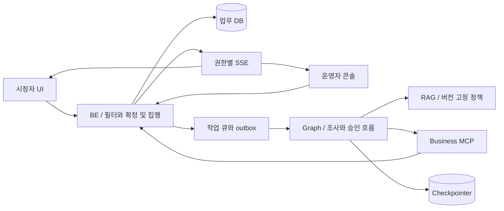
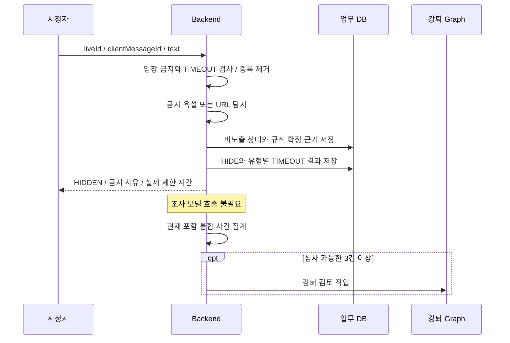
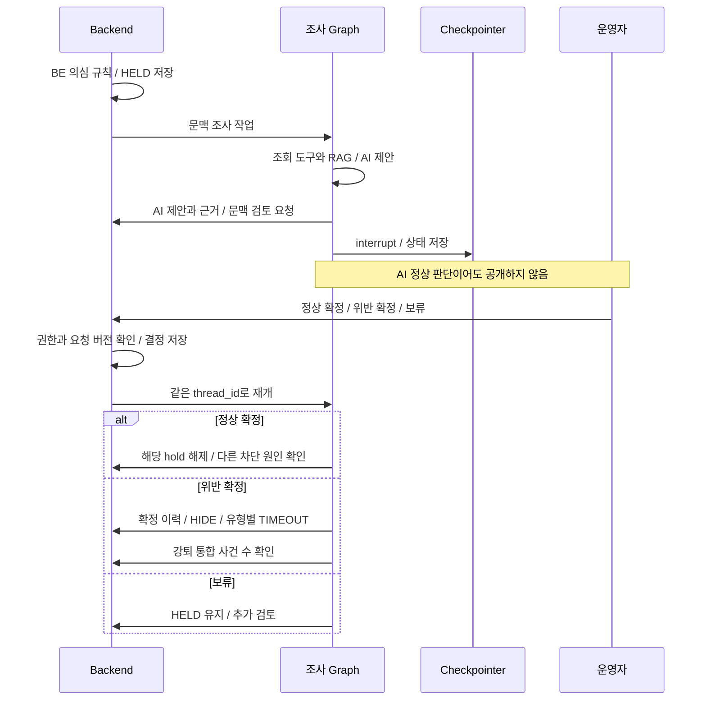
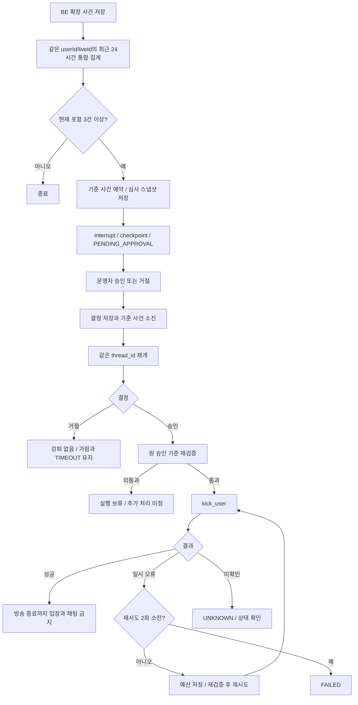
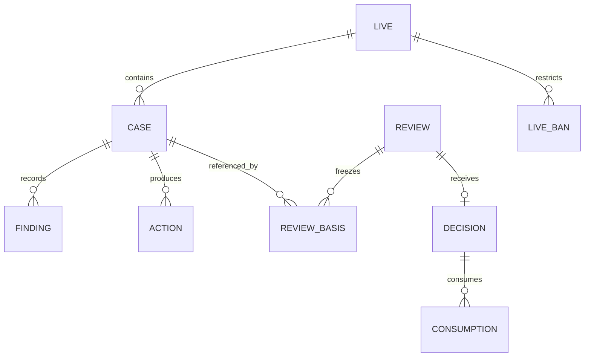

# LIVE:GUARD | 시스템 아키텍처

> 개정일: 2026-10-20 | 정책 원본: [POLICY.md](POLICY.md)
> 
> 
> 기술 구성은 기존 Vue 3, Spring Boot, FastAPI/LangGraph, FastMCP, PostgreSQL/pgvector, RabbitMQ, Docker Compose를 계승한다. 버전은 별도 고정한다.
> 

## 1. 구성

| 구성 | 책임 |
| --- | --- |
| BE | 욕설/링크 규칙 확정, 초기 비노출, 사건과 finding 저장, 표 계산, liveId 인가 |
| 조사 모델 | 문맥과 개인정보 후보 조사, 근거와 제안 verdict 반환 |
| Graph 실행 노드 | 문맥 운영자 승인 대기, 강퇴 승인 대기, 재개와 재검증 |
| Business MCP | 권한과 버전이 검증되는 BE API 어댑터 |
| RAG | 현행 정책 검색, 과거 인용 예외나 링크 허용 정책 혼입 방지 |
| 업무 DB | 확정 이력, 심사 기준 예약, 결정과 소진, action 결과 |
| Checkpointer | 진행 위치와 재개 상태, 업무 DB 승인 사실을 대체하지 않음 |
| UI | 검토 중과 위반 확정 구분, 작성자 사유, 운영자 판단 및 강퇴 카드 |

## 2. 명확한 규칙 위반 경로

“AI 조사 불필요”는 승인 Graph도 생략한다는 뜻이 아니다. BE 규칙 위반이 세 번째 사건이면 강퇴 Graph의 interrupt/checkpointer를 반드시 거친다. 명확한 규칙 경로에서도 사건과 증거, 정책 버전을 저장한다.

## 3. 문맥 의심 경로

문맥 결정의 운영자 승인은 공개 또는 제재에 대한 결정이다. 강퇴 승인을 겸하지 않는다. 문맥 확정 후 3건 조건에 도달하면 같은 Graph가 다음 강퇴 대기 단계로 이동할 수 있으며, 각각 reviewId와 reviewKind를 구분한다. 여러 interrupt를 사용하는 구체 노드 배치는 계약 초안이다.

## 4. 개인정보와 도배 경로

개인정보는 패턴만으로 확정하지 않고 AI가 근거를 조사한다. NO_VIOLATION은 해당 hold 해제, VIOLATION은 BE 검증 후 확정과 표 적용, NEEDS_REVIEW는 HELD 유지 및 운영자 검토다. 개인정보 검토에 문맥의 필수 승인 정책을 자동 확장하지 않는다.

도배는 같은 userId/liveId의 반복 카운터로 세 번째부터 HELD한다. 최초 확정 주체는 TBD-11이다. 확정 이후 24시간 재적발 상태는 문장 식별값과 사건/안내 참조로 저장한다. 제한 중 거부된 전송과 네트워크 재전송은 카운터와 사건을 늘리지 않는다. 재적발의 사건 묶기와 시각 경계는 미정 등록부를 따른다.

## 5. 강퇴와 소진 흐름

재시도 재검증이 실패하면 다시 호출하지 않는다. 승인 기준이 결정 시 소진됐다는 사실만으로 자기 승인을 무효화하지 않는다. 신규 심사는 소진 제외 쿼리를, 승인 실행은 원 reviewId 기준의 유효성 쿼리를 사용한다.

## 6. 데이터 관계와 원자성

| 기록 | 책임과 불변식 |
| --- | --- |
| case와 finding | 사건 수와 유형 수 분리, AI 제안과 BE 확정 분리 |
| review basis | 검토에 사용한 사건 ID와 정책/증거 버전 고정 |
| reservation | 대기 중 다른 심사가 같은 사건을 사용하지 못하도록 함 |
| decision와 consumption | 승인 또는 거절 완료와 기준 사건 소진을 일관되게 저장 |
| action | 멱등 키, 실행 결과, 시도 횟수 유지 |
| live ban | userId/liveId, 근거 actionId, 방송 종료 기반 유효성 |

결정 저장과 소진이 일부만 성공한 상태를 완료로 표시하지 않는다. 업무 DB 트랜잭션 또는 이에 준하는 복구 가능한 처리와 outbox를 사용한다. checkpoint와 업무 DB 간 재개는 저장된 decisionId로 확인하며 메시지의 승인 문자열만 신뢰하지 않는다.

## 7. 재검증

| 검증 | 처리 |
| --- | --- |
| 운영자 권한과 승인 결정 | 서버에 저장된 APPROVE와 대상 review 확인 |
| 대상 | 동일 userId/liveId인지 확인 |
| 기준 사건 | 원 기준 집합, 확정 상태, 취소 여부, 24시간 범위 확인 |
| 소진 | 이 승인 결정이 소진한 근거는 허용, 타 심사 소진은 재사용 금지 |
| 정책과 증거 | 변경 또는 불일치 확인, 승인 근거를 새 사건으로 교체하지 않음 |
| 방송 상태 | 종료된 liveId에 활성 금지를 새로 만들지 않음 |
| 중복 실행 | 기존 action 성공이면 실제 강퇴를 반복하지 않음 |

시간창 이탈이나 취소로 3건을 충족하지 못하면 실행하지 않는다. 재검토 또는 종료 상태, 승인 유효기간은 TBD-06이다. 강퇴 실패 뒤 소진을 자동 취소하지 않는다.

## 8. 서버 집행과 화면

| 기능 | 구현 기준 |
| --- | --- |
| 입장 | 활성 live ban 조회, 해당 liveId 재입장 거부 |
| 기존 접속 | 강퇴 이벤트와 서버 연결/권한 무효화, UI만 닫는 방식 불가 |
| 채팅 | active ban 및 TIMEOUT 검사, 제한 중 전송 거부 |
| 방송 종료 | liveId 종료 상태로 ban 효력 종료, 기록 보존 |
| 새 방송 | 새 liveId, 이전 제재와 카운터 승계 없음 |
| 작성자 안내 | 욕설 포함 또는 링크 금지 등 실제 근거, 적용된 TIMEOUT만 표시 |
| 운영자 목록 | 문맥 확정 검토와 강퇴 승인 검토를 별도 구분 |
| 일반 시청자 | HELD/HIDDEN 원문을 최초 발행, 이력, 재접속 어디에서도 제공하지 않음 |

## 9. 실패 처리

| 상황 | 처리 |
| --- | --- |
| worker 재시작 | 원 thread_id와 checkpoint, DB 결정 및 예산 복원 |
| 중복 결정 | 버전과 요청 ID로 1회 수락 |
| 중복 실행 | actionId와 멱등 키로 실제 효과 1회 |
| kick 일시 오류 | 최초 + 재시도 최대 2회, 한도 소진 FAILED |
| 응답 유실 | UNKNOWN, 결과 확인 전 실패 단정 금지 |
| 알림 실패 | 조치와 별도 상태로 기록, 재제재 금지 |
| HIDE 성공 / TIMEOUT 실패 | 결과 분리, 숨김 유지, 후속 진행 세부 합의 필요 |
| 문맥 검토 지연 | HELD 유지, 자동 공개 규칙 없음 |

확정 요구는 [PROJECT.md](PROJECT.md)의 인수 시나리오로 증명한다. Mermaid는 설계 도식이며 구현 완료 증거를 대신하지 않는다.