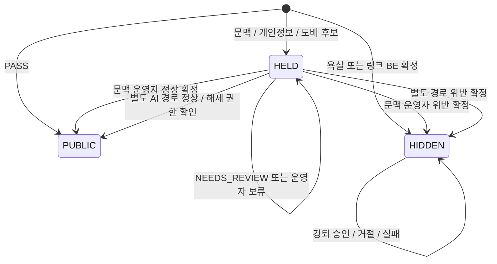

# LIVE:GUARD | 운영정책 및 제재 기준

> 개정일: 2026-10-23 (v3.2: 집단 대상 비하·배제를 HARASSMENT에 포함, 개인정보는 형태 기반 금지) | 2026-10-20 최신 이미지와 후속 사용자 합의 반영
> 
> 
> 미정 상세는 [PROJECT.md](PROJECT.md), 구현 계약은 [CONTRACTS.md](CONTRACTS.md)를 참조한다.
> 

## 1. 기본 원칙

명확한 욕설과 링크 전송은 BE 규칙으로 위반 확정한다. 문맥 의심 채팅은 BE가 후보를 고른 뒤 HELD하고 AI 조사와 운영자 결정을 거친다. AI 정상 판단만으로 문맥 후보를 공개하지 않는다. 개인정보 후보는 별도 AI 판단 경로를 유지한다.

확정 위반 대상은 HIDE한다. TIMEOUT은 아래 제재표에 따라 적용하며 모든 첫 위반에 TIMEOUT이 있는 것은 아니다. 강퇴는 자동 집행하지 않고 운영자 승인과 재검증을 거친다.

## 2. 다섯 유형과 판단 주체

| Category | 위반 기준 | 확정 경로 | 안내 |
| --- | --- | --- | --- |
| PROFANITY | 금지 욕설 포함, 인용/설명/제지여도 적용 | BE 명확한 사전 매칭 → 확정 | 메시지에 금지된 욕설이 포함되어 숨김 처리됨 |
| HARASSMENT | 대상에 대한 문맥상 인신공격과 괴롭힘. 정체성 속성으로 구분되는 집단에 대한 열등 단정·배제·차별 요구 포함(v3.2) | BE 의심 후보 → AI 조사 → 운영자 확정 | 운영자가 확정한 공격 사유 |
| FLOOD | 최초 10초 안 동일 문장 3회, 확정 뒤 재적발 규칙 | 최초 확정 주체 TBD-11, 임시 가림과 확정은 구분 | 동일 문장 반복으로 숨김 처리됨 |
| PHISHING | 링크 전송 자체 금지, 사칭은 별도 의미 판단 | 링크는 BE 확정. 사칭 문맥 후보는 AI와 운영자 | 링크 전송 금지 위반. 악성 확인으로 표현하지 않음 |
| PII_EXPOSURE | 개인정보 형태와 노출 문맥 근거. 작성자 본인 정보 포함, 전화번호 형태는 그 자체로 위반. 실재·유효성은 확인하지 않음(v3.2) | BE 패턴과 문맥 후보 → AI 판단, 부족하면 NEEDS_REVIEW | 근거에 따른 개인정보 노출 사유 |

v3.2부터 지역·출신·국적·인종·민족·종교·성별·연령·장애 등 정체성 속성으로 구분되는 집단의 열등성을 단정하거나 그 집단의 배제·차별을 요구하는 표현도 HARASSMENT로 본다(RAG 정책 원문 CP-3.3). 대상 집단과 열등 단정 또는 배제 표현이 모두 확인되어야 한다. 자조, 비판·제지 목적의 인용, 정책·정치적 주장 비판, 열등 단정·배제에 이르지 않는 가벼운 고정관념은 위반이 아니며, 인용·자조의 형식으로 실제 비하를 지지하거나 퍼뜨리면 예외가 아니다. 대상 집단이 불명확하면 NEEDS_REVIEW다. 정체성 속성으로 구분되지 않는 집단(특정 팀의 팬 등)은 해당하지 않는다. 새 위반 유형과 제재 기준은 바꾸지 않으며 v3.1 사건에 소급하지 않는다.

기존 PHISHING enum을 유지하되 “링크 금지”와 “사칭” 사유를 구분해 기록한다. 공식 링크도 예외 없다. URL 탐지 규칙과 우회 표기, 욕설 사전 및 단어 경계는 TBD-01이다. 사전이 모든 욕설을 탐지한다고 가정하지 않는다.

숫자만 있다는 이유로 개인정보 위반을 확정하지 않는다. 전화번호나 계좌 형태와 개인정보 공개 문맥 등 후보 신호를 활용한다. v3.2부터 개인정보 노출 금지는 그 정보가 실제 개인의 유효한 정보인지와 관계없이 개인정보 형태로 판단되면 적용하며, 작성자가 자기 정보를 스스로 공개하는 경우도 포함한다. 전화번호 형태는 본인·타인, 실재·유효 여부와 관계없이 위반이고, 경고·인용·제지 목적이어도 번호를 그대로 쓰면 문맥 판단의 정상 예외를 적용하지 않는다(번호 없는 경고는 정상). 계좌번호·주소·계정정보 등 다른 개인정보는 형태와 노출 문맥으로 판단하며, 실재·소유자·유효성 확인 결과가 없어도(UNKNOWN) 위반으로 판정할 수 있다. 형태나 문맥이 불충분하면 NEEDS_REVIEW로 판정한다. 개인정보 경로의 위반은 운영자 결정 없이 확정되므로 PII_EXPOSURE만으로 판정하고, 괴롭힘 등 운영자 결정이 필요한 유형이 함께 해당하면 NEEDS_REVIEW로 넘긴다. BE 패턴 후보만으로 바로 위반을 확정하지는 않는다(AI 조사 경로 유지). v3.1에서는 실체를 확인할 근거가 없으면 추측으로 개인정보라고 확정하지 않았으며, v3.1 사건에 소급하지 않는다.

## 3. 필터 결과와 처리 경로

| FilterResult | 현재 적용 | 초기 가시성 | 후속 |
| --- | --- | --- | --- |
| PASS | 조사 신호 없음 | PUBLIC | Agent 미호출 |
| REVIEW | 기존 공개 조사 enum, 현재 확정 경로에서는 미사용 | 신규 의미 부여 금지 | 필요하면 별도 정책 합의 |
| HOLD | 욕설, 링크, 문맥 의심, 개인정보 후보 | 즉시 비노출 | 명확 규칙은 HIDDEN 확정, 조사 후보는 HELD |
| FLOOD | 동일 userId/liveId, 10초 동일 문장 세 번째부터 | HELD | 도배 확정 후 HIDDEN |

FilterResult만으로 확정 주체를 알 수 없다. `handlingRoute` 같은 별도 경로 값으로 RULE_CONFIRMED, CONTEXT_REVIEW, PII_INVESTIGATION, FLOOD_REVIEW를 구분하는 계약을 사용한다. 이름은 계약 초안이다.

욕설과 링크는 HELD를 거쳐 확정하거나 같은 처리 안에서 HIDDEN으로 저장할 수 있다. 어떤 구현이든 일반 시청자에게 원문을 먼저 공개하면 안 된다. 한 메시지가 이미 명확한 규칙 위반이면 추가 문맥 검토의 정상 결정이 그 HIDE를 풀 수 없다.

## 4. 가시성

| 상태 | 의미 | 작성자 | 다른 시청자 | 담당 운영자 |
| --- | --- | --- | --- | --- |
| PUBLIC | 공개 | 보임 | 보임 | 보임 |
| HELD | 임시 가림, 조사 또는 승인 대기 | 보임 + 검토 중 | 안 보임 | 보임 |
| HIDDEN | 위반 확정 가림 | 보임 + 사유 + 적용된 제한 안내 | 안 보임 | 보임 |

HIDE는 동작이고 HIDDEN은 상태다. TIMEOUT이 없는 첫 욕설에는 “채팅 제한 중”을 표시하지 않는다. 개인정보 원문과 상세 근거는 권한과 마스킹 기준을 적용하며 안내에서 재노출하지 않는다.

### 플랫폼 관리자 관제 권한 (#88)

PLATFORM_ADMIN은 채널 소속과 무관하게 모든 방송을 관제(MONITOR)하고 확정 위반을 오판 취소(REVOKE)할 수 있다. 문맥·강퇴 결정(DECIDE), 비공개 개인정보 원문 열람(RAW_TEXT), 채팅 전송·방송 시작/종료 권한은 부여하지 않는다. 관리자에게 채널 MODERATOR 소속이 있어도 이 제한은 같다.

관리자 관제는 liveId 기반 이력·채팅 SSE·관제 SSE·사건 상세·검토 목록을 사용한다. HELD·HIDDEN 채팅 이력과 이벤트는 PiiMasker로 마스킹하며, 사건·검토 증거는 기존 마스킹 snapshot을 유지한다. 작성자·담당 운영자의 기존 원문 접근 권한과 일반 시청자 가시성은 바꾸지 않는다. 개인정보가 아닌 공격 표현까지 제거하는 의미 필터는 아니다. 관리자는 deprecated 채널 이력·SSE 경로를 사용할 수 없다.

오판 취소는 기존 사유·버전 검증·멱등성·결정자 감사 기록과 제재 재계산을 그대로 적용한다. 관리자 관제를 이유로 사람 승인이나 강퇴 재검증을 생략하지 않는다. 위반 판단 정책 버전·제재 기준은 변경하지 않는다.

해제는 해당 사건의 hold 원인에만 적용한다. 다른 유효 HIDE 또는 HOLD가 있으면 공개하지 않는다.

## 5. AI 판정과 운영자 결정

| AI verdict | 문맥 의심 경로 | 개인정보 조사 경로 |
| --- | --- | --- |
| NO_VIOLATION | HELD 유지, 운영자 정상 확정 후 공개 | 해당 HELD 해제 가능 |
| VIOLATION | HELD 유지, 운영자 위반 확정 전에는 확정 이력에 미포함 | 근거와 정책 BE 검증 후 확정, HIDE와 표 적용 |
| NEEDS_REVIEW | HELD 유지, 부족한 근거와 함께 운영자 검토 | HELD 유지, 운영자 검토 |

운영자는 AI 결과와 다르게 판단할 수 있다. 문맥 심사 결정은 정상, 위반, 보류로 구분한다. 보류는 공개 승인이 아니다. 운영자 확인 없이 자동 공개하는 대기 만료 규칙을 넣지 않는다.

문맥 검토 승인과 강퇴 승인은 별도다. 문맥 위반 확정으로 통합 사건 수가 3건에 도달하면 그 뒤 강퇴 승인 요청을 따로 생성한다.

## 6. 최신 유형별 제재표

| Category | 이전 확정 0건 | 이전 확정 1건 | 이전 확정 2건 이상 |
| --- | --- | --- | --- |
| PROFANITY | HIDE | HIDE + TIMEOUT 600초 | HIDE + TIMEOUT 86400초 |
| HARASSMENT | HIDE + TIMEOUT 600초 | HIDE + TIMEOUT 86400초 | HIDE + TIMEOUT 86400초 |
| FLOOD | 세 번째 이후 중복 HIDE | 중복 HIDE + TIMEOUT 600초 | 중복 HIDE + TIMEOUT 86400초 |
| PHISHING | HIDE + TIMEOUT 600초 | HIDE + TIMEOUT 600초 | HIDE + TIMEOUT 86400초 |
| PII_EXPOSURE | HIDE | HIDE + TIMEOUT 600초 | HIDE + TIMEOUT 86400초 |

600초는 10분, 86400초는 24시간이다. “이전 확정”은 같은 userId/liveId에서 **해당 유형의 과거 확정 사건**이며 현재 사건은 제외한다. 조회 기간과 부분 취소 기준은 TBD-03이다. 소진은 이 과거 이력을 삭제하지 않는다.

한 사건에 여러 유형이 있으면 HIDE는 한 번, TIMEOUT은 가장 긴 후보 하나만 적용한다. 기간 합산은 하지 않는다. 기존 활성 TIMEOUT의 연장 방식은 TBD-09다. 제한은 해당 liveId에만 적용한다.

“이전 확정 2건 이상” 열은 강퇴 자체가 아니라 해당 사건의 HIDE/TIMEOUT 조치다. 강퇴 심사는 아래 통합 집계를 별도로 통과해야 한다. 유형별 조회 기간이 미정이므로 이 열만 보고 현재 24시간 안에 통합 3건이라고 단정하지 않는다.

## 7. 도배 최초 적발과 재적발

| 상황 | 처리 |
| --- | --- |
| 같은 userId/liveId의 10초 안 동일 문장 1회 또는 2회 | FLOOD 조건만으로 가리지 않음. 다른 규칙은 별도 |
| 세 번째부터 | HELD 후 도배 확정 절차, 첫 확정 사건은 중복 HIDE만 |
| 첫 확정 및 안내 이후 같은 문장을 24시간 안에 다시 전송 | 한 번으로도 새 도배 위반 대상, 유형별 과거 이력으로 제재 |
| TIMEOUT 적용 중 전송 시도 | BE에서 전송 거부, 저장된 새 채팅/위반 사건으로 가산하지 않음 |
| TIMEOUT 종료 후 위 재적발 창 안 같은 문장 | 한 번으로도 재제재 |
| 다른 문장 | 최초 10초 내 동일 문장 3회 기준 적용 |
| 새 liveId | 이전 방송의 재적발 상태를 승계하지 않음 |

첫 적발에는 TIMEOUT이 없으므로 첫 가림 안내 직후 재전송도 재적발 대상이다. 네트워크 중복 재전송은 clientMessageId로 제거한다. 최초 반복 묶음의 끝, 경고 전달과 전송의 경합, 재적발 창을 후속 적발로 갱신할지, 첫 두 메시지 사후 가림은 TBD-04/05/11이다. 재적발 메시지마다 무조건 별도 사건으로 쪼개는 규칙은 아직 확정하지 않았다.

## 8. 강퇴 집계

| 항목 | 확정 기준 |
| --- | --- |
| 범위 | 같은 userId + 같은 liveId |
| 시간 | 최근 24시간, 현재 사건 포함 |
| 대상 | BE에 확정 저장된 위반 사건 |
| 유형 | 다섯 유형 통합 |
| 한 건 | 서로 다른 사건 1개, 같은 사건 다중 유형 1건 |
| 제외 | 취소, 소진, 중복, 미확정 후보 |
| 심사 요청 | 3건 이상 |
| 실행 | 운영자 승인 + 같은 thread_id 재개 + 재검증 |

| 예시 | 결과 |
| --- | --- |
| 욕설 1사건 + 도배 1사건 + 링크 1사건 | 통합 3건, 강퇴 승인 요청 |
| 한 사건에 욕설과 괴롭힘 | 통합 1건 |
| 과거 2사건 + 현재 1사건 | 통합 3건 |
| 3개 중 하나가 오판 취소 | 유효 2건, 요청하지 않음 |
| TIMEOUT 시간만 만료 | 위반 기록 유지, 시간창 안이면 집계 가능 |
| AI 위반 제안만 있고 문맥 운영자 미결정 | 확정 사건 아님 |

대기 중인 심사에 사용된 사건은 예약 상태로 관리해 다른 심사에 중복 사용하지 않는다. 예약은 소진 또는 판정 취소와 구분한다.

## 9. 결정, 소진, 승인 재검증

| 시점 | 기준 사건 상태 | 결과 |
| --- | --- | --- |
| 심사 요청과 대기 | 해당 reviewId에 예약 | 같은 사건으로 중복 요청 방지 |
| 승인 결정 완료 | 기준 사건 소진 | 향후 새 강퇴 심사 집계에서 제외, 원 승인 실행은 진행 가능 |
| 거절 결정 완료 | 기준 사건 소진 | 강퇴 없음, 기존 HIDE와 TIMEOUT 유지 |
| 승인 후 실행 실패 | 소진 유지 | 자동 복구나 새 승인 생성 금지, 재시도 정책에 따름 |

위반 사실과 유형별 TIMEOUT 이력은 소진 후에도 남는다. 소진된 사건을 자동 재활성화하지 않는다. 취소는 위반 판단의 무효화이고, TIMEOUT 만료는 제한 시간 종료다.

**재검증은 신규 심사용 집계와 다르다.** 승인 완료 시 이미 소진되므로 `소진 제외 집계 >= 3`을 그대로 재사용하면 모든 승인이 막힌다. 승인 실행은 저장된 기준 집합을 검사하고 **해당 reviewId/decisionId가 소진한 사건만** 자기 승인 근거로 인정한다. 취소, 시간창 이탈, 다른 심사에서의 소진, 대상 또는 liveId 불일치는 여전히 검증한다. 기준을 새 사건으로 몰래 교체하지 않는다.

## 10. 강퇴 효과와 실패

강퇴는 현재 방송에서 퇴장시키고 **해당 liveId의 방송 종료까지 재입장과 채팅을 금지**한다. 실행 후 24시간으로 만료시키지 않는다. 방송이 24시간 넘게 계속되면 금지도 유지한다. 새 liveId에는 적용하지 않는다.

방송 종료를 서버 상태로 확인하고, 입장 API와 채팅 API 및 기존 접속에 실제로 반영해야 한다. 이미 끝난 liveId를 강퇴 성공으로 가장하지 않는다. 그 경우 실행 결과 표기는 계약 합의 대상이다.

kick_user의 확인된 일시 오류는 최초 실행 후 최대 2회 재시도한다. 최초 포함 최대 3회 뒤 한도 소진이면 FAILED다. 결과 미확인은 실패라고 단정하지 않고 UNKNOWN으로 관리한다. 오류 코드, 대기 간격, 수동 재시도는 TBD-07이다. 강퇴 실패를 이유로 기존 가림을 풀지 않는다.