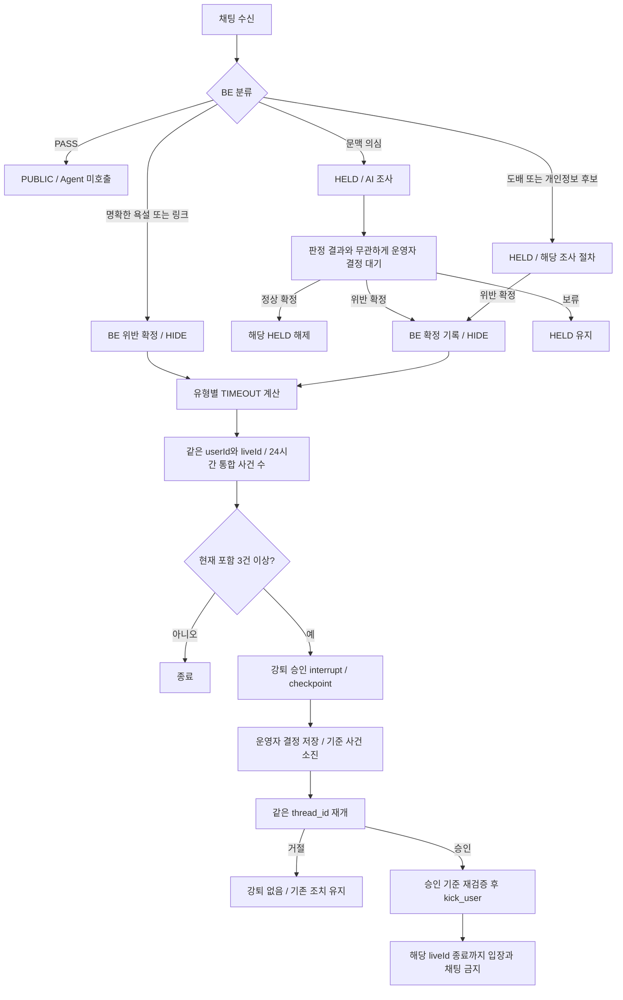

# LIVE:GUARD | 공통 프로젝트 기준

> 개정일: 2026-10-20 | 개정 식별: 사용자 추가 합의 반영본
> 
> 
> 이 문서의 개정 식별은 배포용 policyVersion 승인을 뜻하지 않는다.
> 

## 1. 목적과 문서 구성

LIVE:GUARD는 라이브 채팅의 명확한 금지 행위를 Backend에서 처리하고, 문맥이 필요한 후보를 AI와 운영자가 검토하는 관제 시스템이다. 반복 위반은 운영자 승인 후 해당 방송에서 강퇴한다.

| 문서 | 기준 내용 |
| --- | --- |
| [PROJECT.md](PROJECT.md) | 합의 요약, 변경 내역, 미정 등록부, 인수 기준 |
| [POLICY.md](POLICY.md) | 판정 경로, 가시성, 제재표, 집계와 소진 |
| [ARCHITECTURE.md](ARCHITECTURE.md) | Backend, Agent, MCP, 승인과 저장 및 재개 |
| [CONTRACTS.md](CONTRACTS.md) | 데이터, 도구, API, 실행 상태와 검증 계약 |

정책 의미는 최신 사용자 합의를 우선한다. API 경로와 신규 필드명은 구현 계약 초안이다. 미정 항목에 임의 기본값을 넣지 않는다. 이 문서는 자체 캡스톤 정책이며 실제 플랫폼의 공식 기준이나 과제의 의무 수치를 뜻하지 않는다.

## 2. 식별자와 범위

Phase 2 프로필의 확정 API·DTO 명세는 [프로필 계약](../phase2-harassment-contracts.md)을 따른다(#90).
활성 v3.2 의미를 덮지 않도록 신규 계약은 v3.3/evidenceSchemaVersion=2로 구분한다.
현재는 명세 단계이며 기존 방송·사건·런타임 활성 정책을 바꾸지 않는다.
프로필 변경은 플랫폼 관리자만, 방송 소유자·담당 moderator는 조회만 가능하다.
평가셋 작성·실제 모델 평가 및 운영 활성화는 후속 작업이다.

| 식별자 | 이 문서의 의미 | 정책 적용 |
| --- | --- | --- |
| userId | 제재 대상 계정 | 같은 계정인지 서버에서 확인 |
| liveId | 한 번 시작해서 종료되는 방송 세션 | 집계, 도배 재적발, TIMEOUT, 강퇴의 범위 |
| channelId | 구현에 존재한다면 진행자의 고정 채널 | 정책 범위를 대체하지 않음 |
| caseId | 서로 다른 위반 사건 | 같은 사건의 여러 유형은 강퇴에서 1건 |
| threadId / thread_id | Graph 실행 식별자 | 승인 후 중단 당시와 같은 값으로 재개 |

팀에서 “채널”을 방송 하나라는 뜻으로 부를 수 있다. 그래도 계약에서는 liveId를 사용한다. 같은 진행자가 방송을 종료하고 새 방송을 열면 새 liveId다. 기존 liveId의 제재와 집계 이력을 새 방송에 적용하지 않는다. 기록은 감사 목적으로 남는다.

## 3. 확정 처리 경로

| 경로 | 초기 노출 | 판단과 승인 | 결과 |
| --- | --- | --- | --- |
| PASS | PUBLIC | Agent 미호출 | 공개 유지 |
| 명확한 욕설 포함 | 즉시 비노출 | BE 규칙으로 위반 확정, 인용 예외 없음 | HIDDEN + 유형별 표 |
| 링크 포함 | 즉시 비노출 | BE 규칙으로 링크 금지 위반 확정, AI 조사 불필요 | HIDDEN + PHISHING 표 |
| 문맥 의심 | HELD | AI 조사 후 정상/위반/보류 모두 운영자 결정 필수 | 정상 확정 시 공개, 위반 확정 시 HIDDEN + 표 |
| FLOOD | 대상 메시지 HELD | 최초 10초 내 동일 문장 3회, 재적발 규칙 적용 | 확정된 도배 대상 HIDE + 표 |
| 개인정보 후보 | HELD | BE 후보 탐지 후 AI 조사, 근거 부족 시 NEEDS_REVIEW | 정상은 해제, 확정 위반은 HIDE + 표 |

FLOOD의 최초 확정 주체와 개인정보에 운영자 승인을 항상 적용할지는 새로 확정하지 않는다. 개인정보는 기존 AI 판정 경로를 유지하며, **모든 AI 판단에 무조건 운영자 승인**을 확장하지 않는다. 이번에 필수 승인이 추가된 대상은 문맥 의심 경로다.

## 4. 이번 개정의 주요 변경

| 이전 문서 | 이번 확정 |
| --- | --- |
| 욕설도 인용이나 제지 예외 검토 | 금지 욕설이 포함되면 예외 없이 제재, 작성자에게 이유 안내 |
| 링크 존재만으로 위반 확정 금지 | 링크 전송 자체 금지, BE 처리, 악성으로 확인했다는 안내 금지 |
| REVIEW 문맥 후보를 공개 후 조사 | 문맥 의심은 HOLD/HELD, AI 판단과 무관하게 운영자 결정 필수 |
| 모든 위반 판단이 Agent 중심 | 규칙 확정과 AI 제안을 구분, BE 확정 기록만 집계 |
| 기존 PHISHING 86400/604800/604800초 | 최신 이미지의 600/600/86400초 |
| HARASSMENT 세 번째 604800초 | 86400초 |
| PII_EXPOSURE 두 번째 HIDE만 | HIDE + 600초, 세 번째 86400초 |
| 강퇴 범위와 기간 미정 | 같은 liveId, 방송 종료까지, 새 방송에는 승계하지 않음 |
| 소진 의미 미정 | 승인 또는 거절 결정 완료 시 기준 사건 소진, 향후 강퇴 집계 제외 |
| 소진과 TIMEOUT 이력 관계 미정 | 위반 사실과 유형별 TIMEOUT 과거 이력 보존 |
| 다중 TIMEOUT 후보 선택 미정 | 최장 기간 하나만 적용 |

## 5. 미정 등록부

| ID | 남은 결정 | 현재 확정된 경계 |
| --- | --- | --- |
| TBD-01 | 욕설 사전과 경계 매칭, 변형 욕설, URL 우회 표기와 파서 | 명확한 욕설과 탐지된 링크는 금지. 모든 표현을 탐지한다고 보장하지 않음 |
| TBD-02 | BE 문맥 의심 규칙, 복수 신호 우선순위 | BE 후보만 조사, 문맥 후보는 HELD. PASS 우회 공격 누락 가능 |
| TBD-03 | TIMEOUT 유형별 과거 이력의 조회 기간, 기준 시각, 부분 취소 방식 | 같은 userId/liveId, 현재 제외, 유형별. 소진은 이력을 지우지 않음 |
| TBD-04 | 사건 묶기와 종료, FLOOD 첫 두 메시지의 사후 처리, 부분 유형 취소 | 같은 사건 다중 유형은 1건, 도구 재시도는 새 사건 아님 |
| TBD-05 | 24시간 경계와 기준 시각, FLOOD 정규화와 10초 경계 | 강퇴 현재 포함 24시간, 도배 동일 사용자와 liveId |
| TBD-06 | 3건 초과 시 심사 기준 집합 선택, 승인 유효기간, 재검증 탈락 후 처리 | 대기 중 같은 사건 재사용 금지, 결정 시 기준 사건만 소진 |
| TBD-07 | kick 일시 오류 코드, 간격, UNKNOWN 확인 절차, 수동 재시도 | 일시 오류 최대 2회 재시도, 최초 포함 최대 3회, 한도 소진 FAILED |
| TBD-08 | 활성 policyVersion, 정책 원문과 RAG 색인, 배포 프로필 ID | BE, Agent, RAG 버전 일치 |
| TBD-09 | 활성 TIMEOUT의 연장과 중첩 | 한 사건의 여러 후보 중 최장 하나, 자동 기간 합산 금지 |
| TBD-10 | 운영자 검토 대기 만료와 재배정, 보류 해결 화면 세부 | 문맥 후보는 운영자 정상 확정 전 공개 금지 |
| TBD-11 | 최초 FLOOD 확정 주체와 재적발 기준 시각 | 첫 확정 뒤 같은 문장을 24시간 안에 한 번만 재전송해도 재제재. TIMEOUT 중 전송은 차단 |
| TBD-12 | 강의의 변경 도구 사전 승인 요구와 자동 제재 정합성 | 사용자 설계를 구현 기준으로 유지, 과제 충족을 단정하지 않음 |

표현 “최근 24시간”을 TIMEOUT 이력 조회 기간으로 자동 확장하지 않는다. 현재 확정된 24시간은 강퇴 집계와 도배 재적발 창이다.

## 6. 인수 증거

| ID | 상황 | 기대 결과 |
| --- | --- | --- |
| AC-01 | PASS | PUBLIC, Agent 호출 없음 |
| AC-02 | 인용문 안에 금지 욕설 | HIDDEN, 욕설 포함 안내, 첫 PROFANITY는 TIMEOUT 없음 |
| AC-03 | 공식 사이트 링크 | BE 링크 금지 확정, 첫 PHISHING TIMEOUT 600초 |
| AC-04 | 문맥 후보에 AI 정상 판단 | HELD 유지, 운영자 정상 확정 후 공개 |
| AC-05 | 문맥 후보에 AI 위반 판단 | 승인 전 집계하지 않음, 운영자 위반 확정 후 표 적용 |
| AC-06 | 숫자만 전송 | 숫자라는 이유만으로 위반 확정하지 않음 |
| AC-07 | 개인정보 근거 부족 | HELD 유지, NEEDS_REVIEW |
| AC-08 | 10초 안 동일 문장 3회 | 세 번째부터 HELD, 도배 확정 후 첫 사건 HIDE만 |
| AC-09 | 도배 가림 안내 뒤 같은 문장 재전송 | 같은 liveId의 24시간 재적발 규칙 적용 |
| AC-10 | TIMEOUT 중 전송 시도 | BE 차단, 새 채팅/위반 사건으로 가산하지 않음 |
| AC-11 | 한 사건 여러 유형 | 강퇴 집계 1건, TIMEOUT 최장 하나 |
| AC-12 | 통합 확정 사건 2건 | 강퇴 심사 요청 없음 |
| AC-13 | 과거 2건 + 현재 1건 | interrupt/checkpoint, 재시작 후에도 승인 대기 |
| AC-14 | 강퇴 승인 | 기준 사건 소진, 같은 thread_id 재개, 승인 기준 재검증 후 실제 강퇴 |
| AC-15 | 강퇴 거절 | 기준 사건 소진, kick 없음, HIDE와 TIMEOUT 유지 |
| AC-16 | 결정 시 소진된 승인 기준 | 자기 승인에 사용된 소진만 재검증에서 허용, 타 심사 소진 재사용 금지 |
| AC-17 | 취소, 중복, 대기 중 예약 사건 | 가산 또는 중복 심사 없음 |
| AC-18 | 중복 승인과 worker 재시작 | 결정 1회, 실제 강퇴 1회, 재시도 예산 유지 |
| AC-19 | 방송 24시간 초과 지속 | 강퇴 재입장 금지 유지 |
| AC-20 | 진행자가 새 liveId로 시작 | 이전 강퇴와 TIMEOUT으로 입장/채팅 차단하지 않음 |
| AC-21 | 단순 TIMEOUT 만료 | 위반 사실을 취소하거나 집계 이력을 삭제하지 않음 |

## 7. 출처와 적용 상태

이번 대화의 사용자 합의와 최신 첨부 제재표를 최우선으로 반영했다. 이전 대화 「캡스톤 주제 추천」의 POLICY(1).md와 기존 개발 명세 및 인터페이스 계약을 기반으로 재구성했다. GitHub 이슈 #5는 직접 열람되지 않아 사용자가 붙여 준 조건과 제안을 참고했으며 원문 검증을 주장하지 않는다.

기존 PROJECT, ARCHITECTURE, CONTRACTS 원본은 확인 가능한 첨부에 없어 이전 개정부터 재구성 문서였다. sources의 동기화 자료는 변경하지 않는다. 과거 정책의 인용 예외, 링크 의미 판정, REVIEW 공개 경로와 이번 확정 정책이 충돌하면 이번 정책을 따른다.